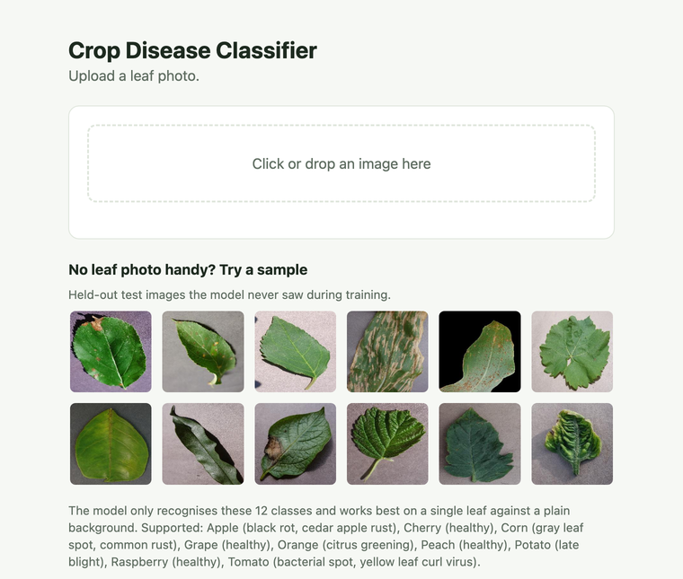

# Crop Disease Classifier

Image classifier for plant leaf diseases, trained on 12 classes of the
[PlantVillage dataset](https://www.kaggle.com/datasets/abdallahalidev/plantvillage-dataset)
and served as a FastAPI app on Vercel.

**Live demo: https://crop-disease-classifier.vercel.app**

<a href="https://crop-disease-classifier.vercel.app"></a>

**Main notebook: [`crop_disease_classification.ipynb`](crop_disease_classification.ipynb)**: data exploration,
training, evaluation and business recommendation, with explanations.

## Key findings

- **Data:** 54,305 images, 38 classes, 36 : 1 class imbalance. 12 random classes used (18,600 images after
  removing 21 duplicates), split 70 / 20 / 10 stratified.
- **Shortcut risk:** images are lab photos and background brightness differs strongly by class, so the very
  high test accuracy is likely optimistic for real field photos.
- **Errors:** MobileNetV3-Small gets 3 of 1,953 test images wrong, all with confidence below 80%; correct
  predictions have a median confidence of 100%. An 80% threshold catches all 3 errors.

## Model comparison (held-out test set)

| Model | Accuracy | Macro F1 | Params (M) | Size (MB) | CPU latency (ms) |
|---|---|---|---|---|---|
| small_cnn | 0.936 | 0.927 | 0.39 | 1.6 | 83.6 |
| **mobilenet_v3_small** | **0.998** | **0.998** | 1.53 | 6.2 | 35.3 |
| resnet18 | 0.992 | 0.987 | 11.18 | 44.8 | 55.9 |
| regnet_x_400mf | 0.998 | 0.998 | 5.10 | 20.7 | 25.0 |

CPU latency: median time for one image on a single CPU thread. Pretrained models were fine-tuned from ImageNet
weights; `small_cnn` was trained from scratch.

## Business recommendation

**Deploy MobileNetV3-Small in Syngenta's farmer app.** It ties for the best test result (99.8% accuracy,
0.998 macro-F1) with RegNetX-400MF but is 3.3× smaller (6.2 MB vs 20.7 MB), which matters for farmers who
download apps over slow rural connections and need diagnosis to work offline on low-cost phones. At 35 ms per
image on one CPU thread it is far faster than a user can notice, and it was designed for mobile chips, so it
converts directly to TensorFlow Lite / Core ML / ONNX and can be quantised to int8 for a further ~4× size
reduction. ResNet18 is 7× larger and less accurate, and the small CNN makes about 40× more errors, which is
not acceptable when a wrong diagnosis means the wrong crop protection product. Before launch, the model must
be validated on real field photos (PlantVillage images are lab photos), and the app should ask for a retake
when confidence is below 80%.

### Classes

| Crop | Condition |
|---|---|
| Apple | Black rot |
| Apple | Cedar apple rust |
| Cherry | Healthy |
| Corn (maize) | Cercospora leaf spot / Gray leaf spot |
| Corn (maize) | Common rust |
| Grape | Healthy |
| Orange | Huanglongbing (citrus greening) |
| Peach | Healthy |
| Potato | Late blight |
| Raspberry | Healthy |
| Tomato | Bacterial spot |
| Tomato | Yellow leaf curl virus |

## Project layout

```
crop_disease_classification.ipynb  Main notebook: EDA, training, evaluation, recommendation
train.py                           Same pipeline as a script (trains and saves all 4 models)
mobilenet_v3_small.pt              Trained weights of the chosen model (PyTorch state_dict)
export_onnx.py                     Converts mobilenet_v3_small.pt -> model/mobilenet_v3_small.onnx
model/                             Deployed ONNX model
app.py, public/                    Web app (FastAPI) and upload page
data/pull_data.py                  Downloads the dataset via kagglehub
archive/                           Earlier working notebooks (superseded by the main notebook)
```

## API

```bash
curl -F "file=@leaf.jpg" "https://crop-disease-classifier.vercel.app/api/predict?top_k=3"
```

Example response (`top_k` lists the 3 most likely classes; shortened here):

```json
{
  "prediction": {"label": "Tomato___Bacterial_spot", "crop": "Tomato", "condition": "Bacterial spot", "confidence": 0.998},
  "top_k": [
    {"label": "Tomato___Bacterial_spot", "crop": "Tomato", "condition": "Bacterial spot", "confidence": 0.998}
  ]
}
```

`GET /api/health` returns the model name and class list.

## Run locally

```bash
pip install -r requirements.txt uvicorn
uvicorn app:app --reload
# open http://localhost:8000
```

## Setup: notebook and training

Requires Python 3.10+ and a free Kaggle account (the dataset downloads automatically via `kagglehub`).

```bash
python -m venv .venv && source .venv/bin/activate
pip install -r requirements-train.txt jupyter
jupyter notebook crop_disease_classification.ipynb
```

The notebook loads the saved weights by default (`TRAIN = False`); set `TRAIN = True` to retrain all four
models (about 1–2 hours on a GPU, much longer on CPU). Alternatively:

```bash
python train.py           # trains and saves <model>.pt
python export_onnx.py     # exports the chosen model to model/
```

## Deploy

Vercel detects the FastAPI `app` in `app.py` and installs `requirements.txt`.
Import the GitHub repo at https://vercel.com/new (no settings needed), or run `vercel --prod`.

## Limitations

PlantVillage images are lab photos of single leaves on plain backgrounds; accuracy on field photos
will be lower. The model only knows these 12 classes and will always pick one of them.
